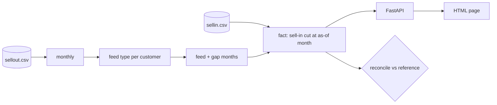

# Commercial analytics dashboard: data model summary (synthetic exercise)

Compares what a fictional manufacturer ships to customers (sell-in) with what customers sell on (sell-out) against a target. All names and numbers are generated.

## Status
- Runs end to end from generated CSVs. The 6 tests pass, including a reconciliation guard.
- Not included: product pages, stock transfers between customers, weekly period type, more than two period types.

| Object | Grain | Role |
|---|---|---|
| `data/sellout.csv` | day or month x channel x customer | sell-out, with a `period_type` (monthly or daily) |
| `data/sellin.csv` | month x channel x customer | shipments |
| `data/target.csv` | month x channel | sales target (no customer split) |
| `data/reference_totals.csv` | channel | independent reference total for reconciliation |
| `data/truth.csv` | customer x month | ground truth used only by the tests |

## 1. Problem and process
Show sell-through (sell-out / sell-in) and target attainment by channel, so the page can never drift from its source rows.

The generator creates four reporting situations on purpose:

| Customer | Situation | Rule that handles it |
|---|---|---|
| Retailer A | monthly feed, last report is month 11 | sell-in is cut at the customer's last sell-out month |
| Retailer B | monthly months 1-9, then only daily rows | gap months are read from the other period type |
| Retailer C | the same sales reported monthly and daily | one feed type per customer, never sum both |
| Marketplace X | daily only | feed type is daily |

## 2. Data flow


## 3. Rules
- **Feed type:** the period type holding the most value, one per channel x customer.
- **Gap months:** a month the feed type does not cover is read from another type. A covered month is never filled, which avoids double counting.
- **As-of cut:** sell-in and sell-out both end at the customer's last sell-out month, so comparisons are like for like.
- **Never sum across period types:** the same sales can exist at more than one granularity.
- **Reconciliation:** each channel's sell-out must match an independent reference within 0.1%. The guard fails loudly.

## 4. Tests
| Check | Fails the run? |
|---|---|
| Feed rules reproduce the ground truth exactly | yes |
| A naive sum across period types double counts | yes (documents why the rule exists) |
| Sell-in is cut at the as-of month | yes |
| Gap months are filled from daily rows | yes |
| Reconciliation guard passes on good data and raises on drift | yes |
| API, status endpoint and page are served | yes |

## 5. Known issues and next steps
- Gap filling assumes two period types. With three, a gap month could match two non-feed types.
- Next: product pages, transfers netted from the sender, a weekly period type, a refresh endpoint.

## 6. How to run
```
python generate_data.py
python -m pytest -q
python -m uvicorn app:app --port 8000     # http://localhost:8000
```
Needs duckdb, fastapi, uvicorn, httpx and pytest.

---
Part of the portfolio at https://astrenot.github.io/Arkananta-Website/. Synthetic data only.
